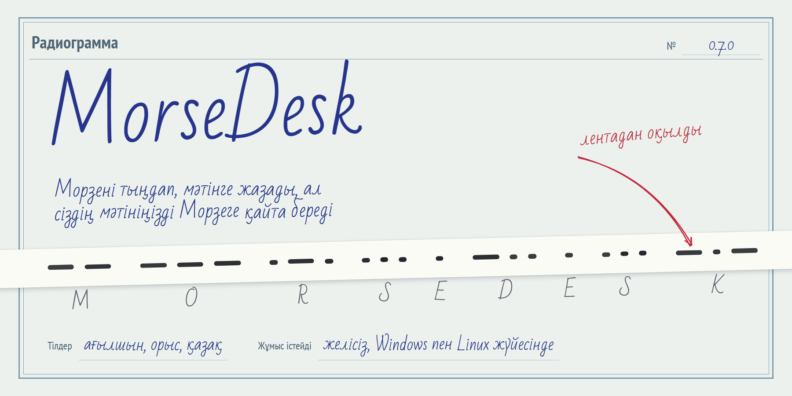
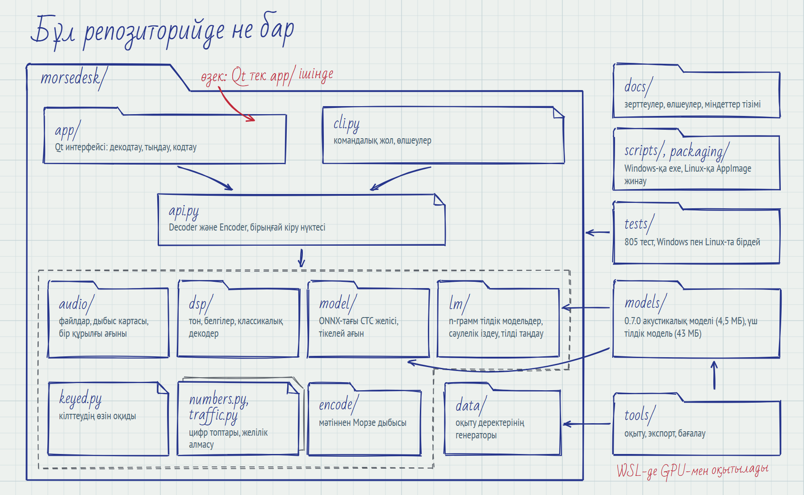
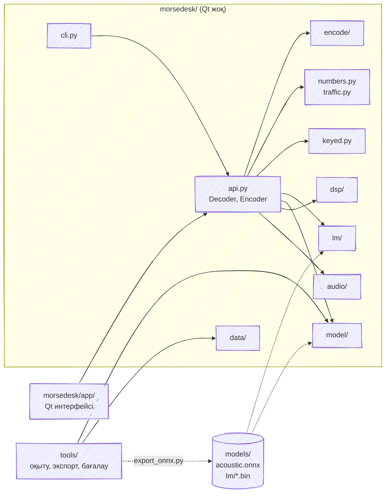
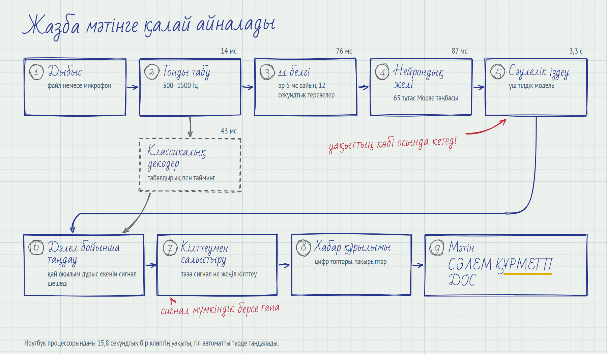
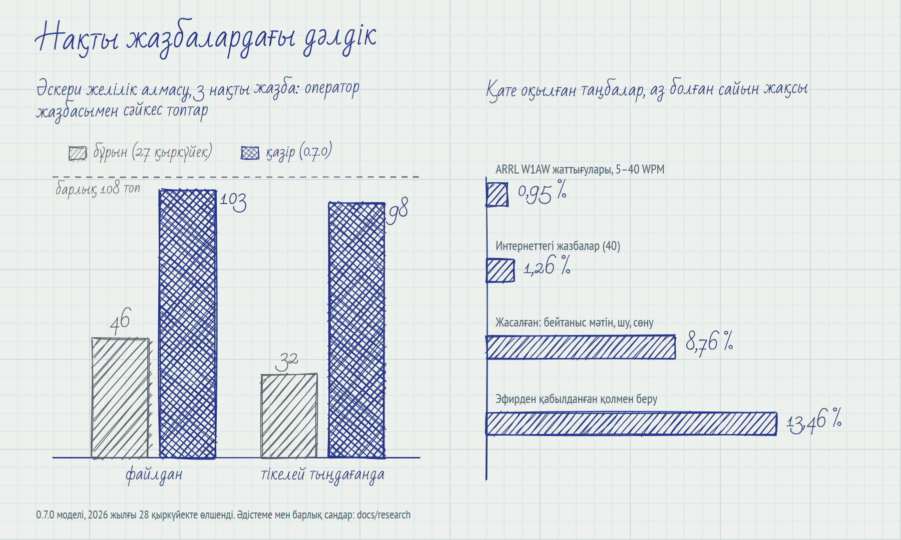

<picture>
  <source media="(prefers-color-scheme: dark)" srcset="docs/readme/img/hero-kk-dark.png">
  
</picture>

[English](README.md) | [Русский](README.ru.md) | **Қазақша**

MorseDesk аудиофайлдардан және дыбыс картасынан Морзе әліппесін декодтайды, ал мәтінді Морзе
дыбысына айналдырады: ағылшын, орыс және қазақ тілдерінде. Бағдарлама Windows пен Linux жүйесінде
желісіз жұмыс істейді. Нейрондық желі, үш тілдік модель және интерфейс осы репозиторийде жатыр,
сондықтан іске қосу үшін оны клондау жеткілікті.

Бұл бет репозиторийді сипаттайды: не қайда жатқанын, декодер қалай жұмыс істейтінін, оны қалай іске
қосу, тексеру, жинау және қайта оқыту керектігін. Бағдарламаны Python-сыз пайдалану үшін
[Releases](https://github.com/manh2303code/morsedesk/releases) бетінен дайын жинақты жүктеп алыңыз.

- [Репозиторийде не бар](#репозиторийде-не-бар)
- [Жазба мәтінге қалай айналады](#жазба-мәтінге-қалай-айналады)
- [Дәлдік](#дәлдік)
- [Жүктеп алу](#жүктеп-алу)
- [Бастапқы кодтан іске қосу](#бастапқы-кодтан-іске-қосу)
- [Тесттер](#тесттер)
- [Шығарылымдарды жинау](#шығарылымдарды-жинау)
- [Оқыту және бағалау](#оқыту-және-бағалау)
- [Құжаттама](#құжаттама)
- [Лицензиялар](#лицензиялар)

## Репозиторийде не бар

<picture>
  <source media="(prefers-color-scheme: dark)" srcset="docs/readme/img/repo-kk-dark.png">
  
</picture>

| Жол | Ішінде не бар |
|---|---|
| `morsedesk/` | Өзек. Qt тек `app/` ішінде импортталады, сондықтан командалық жол мен өлшеулер дисплейі жоқ машинада да жұмыс істейді. |
| `morsedesk/api.py` | `Decoder` және `Encoder`, бірыңғай кіру нүктесі. Интерфейс те, командалық жол да осы арқылы жұмыс істейді. |
| `morsedesk/audio/` | Аудиофайлдарды оқу және жазу, дыбыс картасынан жазу және ойнату. PortAudio-ға барлық шақырулар бір құрылғы ағынынан жасалады. |
| `morsedesk/dsp/` | Тонды іздеу, 11 белгі, классикалық табалдырықтық декодер және екі оқылымның бірін таңдау. |
| `morsedesk/model/` | ONNX Runtime арқылы CTC желісі, 12 секундтық терезелер, тікелей ағын. |
| `morsedesk/lm/` | Таңбалық n-грамм тілдік модельдер, сәулелік іздеу, тілді анықтау. |
| `morsedesk/keyed.py` | Сигнал таза немесе кілттеу жеңіл болғанда мәтінді өлшенген кілттеумен салыстырады. |
| `morsedesk/numbers.py`, `traffic.py` | Цифр топтары мен қысқартылған цифрлар; желілік алмасу хабарларының құрылымы (тақырып, RMKS, топтар). |
| `morsedesk/encode/` | Мәтіннен Морзе таймингі мен дыбысы. |
| `morsedesk/data/` | Синтетикалық оқыту деректері: беру мәнерлері, шу, сөну, кедергілер, мәтін көздері. |
| `morsedesk/app/` | Qt (PySide6) интерфейсі: декодтау, тыңдау және кодтау беттері, үш тілдегі құжаттама. |
| `models/` | `acoustic.onnx`, 0.7.0 моделі (4,5 МБ), және `lm/{en,ru,kk}.bin`, тілдік модельдер (43 МБ). |
| `tools/` | Оқыту, ONNX-қа экспорттау, тілдік модельдерді құру, бағалау және өлшеулер. |
| `tests/` | `unit/`, `app/` (Qt) және `regression/` ішіндегі 805 тест. |
| `scripts/`, `packaging/` | Windows-қа exe және Linux-қа AppImage жинау мен тексеру; Linux-та тесттерді іске қосу. |
| `docs/` | Барлық өлшеулері бар зерттеулер, міндеттер тізімі және осы беттегі суреттердің бастапқы файлдары. |
| `testdata/` | Тек README. Сынақ жазбалары жарияланбайды. |

Сол тәуелділіктер граф түрінде:



## Жазба мәтінге қалай айналады

<picture>
  <source media="(prefers-color-scheme: dark)" srcset="docs/readme/img/pipeline-kk-dark.png">
  
</picture>

1. Тон 300–1500 Гц аралығында ізделеді.
2. Әр 5 мс сайын сигнал 11 белгіге айналады. Ұзын жазбалар бір-бірін 10 секундқа жабатын
   12 секундтық терезелерге бөлінеді.
3. 1 119 425 параметрі бар екі бағытты GRU 65 класс бойынша CTC ықтималдықтарын береді. Әр класс —
   жеке нүкте не сызық емес, `.-` немесе `-...` сияқты тұтас Морзе таңбасы.
4. Сәулелік іздеу осы ықтималдықтарды әр тілдің таңбалық 6-грамм тілдік моделімен біріктіреді.
   Тіл автоматты таңдалғанда үшеуі де сыналады, уақыттың көбі осыған кетеді.
5. Классикалық табалдырықтық декодер сол сигналды қатар оқиды, ал `dsp/selection.py` сигнал
   жақсырақ растайтын оқылымды қалдырады.
6. Сигнал таза немесе кілттеу жеңіл болса, `keyed.py` мәтінді өлшенген кілттеумен салыстырады.
7. `numbers.py` пен `traffic.py` цифр топтарын және желілік алмасу хабарларының құрылымын қалпына
   келтіреді.

Әр таңбаның өз сенімділігі бар, ал интерфейс желі анық естімеген сөздердің астын сызады.

## Дәлдік

<picture>
  <source media="(prefers-color-scheme: dark)" srcset="docs/readme/img/results-kk-dark.png">
  
</picture>

| Жиын | Бұл не | 0.7.0 моделі |
|---|---|---|
| T7 | әскери желілік алмасудың 3 нақты жазбасы, оператор жазбасымен салыстырылды | файлдан 108 топтың 103-і, тікелей тыңдағанда 108-дің 98-і (27 қыркүйекте: 46 және 32) |
| T2 | ARRL W1AW жаттығулары, 5–40 WPM жылдамдықтағы 10 нақты жазба | 0,95 % қате таңба; 18–40 WPM аралығында бірде-бір қате жоқ |
| T4 | интернеттегі 40 нақты жазба | 1,26 % |
| T4, SAQ | эфирден қабылданған қолмен беру | 13,46 %, қалған ең үлкен алшақтық |
| dev-OOV | 500 жасалған клип: модель көрмеген мәтін, шу, кедергі, сөну | 8,76 % |

2026 жылғы 28 қыркүйекте өлшенді. Әр жиынның қалай жиналғаны және барлық сандар қателік шектерімен
`docs/research/` ішінде және бағдарламаның ішіндегі құжаттамада берілген.

## Жүктеп алу

[Releases](https://github.com/manh2303code/morsedesk/releases) бетінде екі файл және олардың
бақылау қосындылары бар:

| Жүйе | Файл |
|---|---|
| Windows | `MorseDesk.exe`, шамамен 140 МБ бір файл. Екі рет шертіп ашыңыз, орнату қажет емес. |
| Linux | `MorseDesk-x86_64.AppImage`. Бір рет `bash install_linux.sh MorseDesk-x86_64.AppImage` командасымен орнатыңыз, скрипт осы репозиторийдің `scripts/` қалтасында. Флешкадан немесе Windows-тан көшірілген файл орындау құқығын жоғалтады, сондықтан оны екі рет шерту ешбір хабарсыз ештеңе істемейді. |

Жүктелген файлды тексеру: `sha256sum -c --ignore-missing SHA256SUMS`.

## Бастапқы кодтан іске қосу

Python 3.11 және [uv](https://docs.astral.sh/uv/) қажет.

```bash
git clone https://github.com/manh2303code/morsedesk
cd morsedesk
uv sync --extra runtime --extra gui     # --all-extras тесттер мен оқытуды қосады
uv run morsedesk-gui
```

Windows-та оның орнына `MorseDesk.cmd` файлын екі рет шертуге болады: алғашқы іске қосуда ол
жетіспейтінін орнатып, интерфейсті ашады. Linux-та тыңдау мен ойнату үшін `libportaudio2` керек.

Командалық жол:

```bash
uv run morsedesk decode recording.wav                    # тіл автоматты таңдалады
uv run morsedesk decode recording.wav --profile ru --json
uv run morsedesk encode "CQ CQ DE R1ABC K" --wpm 20 --out cq.wav
uv run morsedesk devices                                 # дыбыс құрылғыларының тізімі
```

Профильдер: `en`, `ru`, `kk-cyrl-ru` (қазақ) және `auto`. Кирилл мәтіні дұрыс шығуы үшін
Windows-та `PYTHONUTF8=1` орнатыңыз.

## Тесттер

```bash
uv sync --all-extras
PYTHONUTF8=1 uv run pytest -p no:warnings
```

`-p no:warnings` PyTorch ескертулерін қорытындыдан алып тастайды. Бірде-бір тест нақты дыбыс
құрылғысын ашпайды: `tests/conftest.py` барлық тесттер үшін `sounddevice` модулін алмастырады.
`scripts/test_linux.sh` сол тесттерді Linux-та бөлек виртуалды ортада, Qt-ты экрансыз іске қосады.
`gate` белгісі бар тесттер модельді жасалған T1 жиынында (`tools/make_t1.py`) тексереді және
`-m gate` арқылы іске қосылады.

## Шығарылымдарды жинау

Windows, PowerShell 7-де:

```powershell
pwsh -File scripts/build_windows.ps1       # dist/MorseDesk.exe
pwsh -File scripts/test_windows_exe.ps1    # exe-ні іске қосып, --self-test нәтижесін бастапқы кодпен салыстырады
```

Linux-қа арналған AppImage Docker арқылы Ubuntu 22.04 ішінде жиналады:

```bash
docker build -f packaging/Dockerfile.build -t morsedesk-build .
docker run --rm -v "$PWD":/src morsedesk-build bash scripts/build_appimage.sh
# dist/MorseDesk-x86_64.AppImage және dist/SHA256SUMS

docker build -f packaging/Dockerfile.test -t morsedesk-test .
docker run --rm -v "$PWD":/work morsedesk-test bash /work/scripts/test_appimage.sh
```

Алдымен `test_windows_exe.ps1` іске қосыңыз: ол `dist/selftest/` ішіне үлгілер жазады,
`test_appimage.sh` солармен салыстырады. Екі жинақты бір уақытта жинамаңыз: AppImage жинағы Windows
жинағы пайдаланатын `build/` қалтасын тазалайды.

## Оқыту және бағалау

Акустикалық модель тек `morsedesk/data` сол сәтте жасайтын синтетикалық дыбыстан үйренеді: мәтін,
кілттеу, шу, сөну және кедергілер, соның ішінде нақты жазбаларда өлшенген жеңіл кілттеу.

```bash
uv sync --all-extras
PYTHONUTF8=1 uv run python -m tools.train --name my_run --steps 30000 --device auto
PYTHONUTF8=1 uv run python tools/export_onnx.py --checkpoint runs/my_run/best.pt --out models/eval_my_run.onnx
```

Әзірлеуші машинасында оқыту WSL ішінде GPU-мен жүреді (`scripts/wsl_train.sh`, бір қадамға шамамен
0,05 с, 30 000 қадам шамамен жарты сағат). Барлық модельдердің баптаулары
`docs/research/03-model-experiments.md` ішінде.

```bash
PYTHONUTF8=1 uv run python tools/make_t1.py           # T1: 500 жасалған клип
PYTHONUTF8=1 uv run morsedesk bench --manifest testdata/generated/t1/manifest.jsonl --engine onnx --out-dir runs/t1
PYTHONUTF8=1 uv run python tools/long_random_eval.py  # үш тілдегі екі минуттық хабарлар
```

Нақты жазбалар (T2, T4–T7) репозиторийде жоқ: кейбірін тек жоба ішінде пайдалануға болады,
қалғандары жеке. Оларды жинаған құралдар, `tools/fetch_t2.py` және `tools/make_t4.py`,
репозиторийде бар және дереккөздерін көрсетеді.

Тілдік модельдер мәтін корпустарынан KenLM арқылы құрылады: `tools/fetch_corpus.py`, содан кейін
`tools/normalize_corpus.py`, `tools/build_lm.sh` және `tools/arpa_to_bin.py`. Корпустар мен
олардың лицензиялары `models/lm/LICENSES.md` ішінде көрсетілген.

## Құжаттама

- `morsedesk/app/docs/technical_{en,ru,kk}.html`: өлшеулері бар толық техникалық сипаттама.
  Бағдарлама оны интерфейс тілінде көрсетеді және PDF-ке сақтай алады.
- `docs/research/`: барлық тәжірибелер мен өлшеулер (вьетнам тілінде). 02 — бастапқы сандар,
  03 — модель тәжірибелері, 04 — салыстыруға арналған дайын модельдер, 05 — сандар, 06 — желілік
  алмасу және жеңіл кілттеу.
- `docs/backlog.md`: ашық міндеттер.
- `CLAUDE.md`: кодпен жұмыс істеуге арналған жазбалар, архитектура шекаралары және белгілі
  тұзақтар (вьетнам тілінде).
- `docs/readme/`: осы беттегі суреттердің бастапқы файлдары. `uv run python docs/readme/render.py`
  оларды Edge немесе Chrome арқылы қайта салады.

## Лицензиялар

`pyproject.toml` ішінде MorseDesk коды меншікті (proprietary) деп жарияланған; ашық лицензия жоқ.
Үшінші тарап файлдары өз лицензияларын сақтайды: `morsedesk/app/fonts` ішіндегі DejaVu және
Noto Sans қаріптері, `models/lm/LICENSES.md` ішіндегі тілдік модель корпустары, ал
`docs/readme/src` ішінде Bad Script және PT Sans Narrow қаріптері (SIL Open Font License) және
rough.js (MIT).
