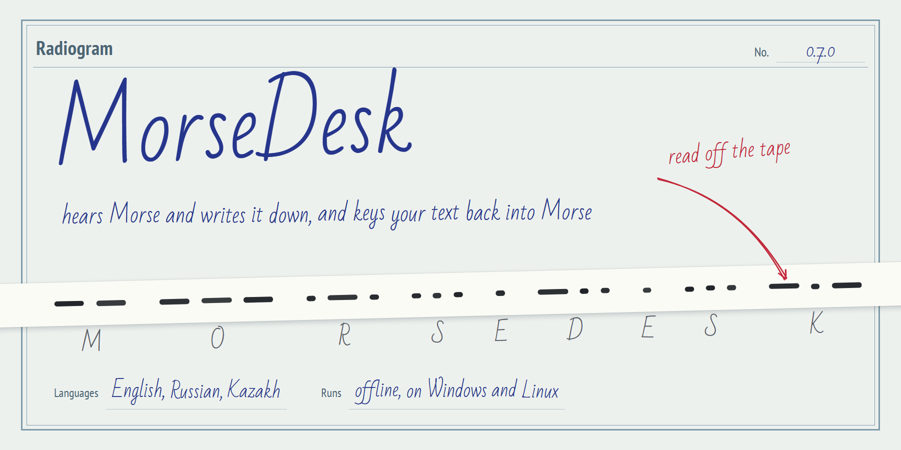
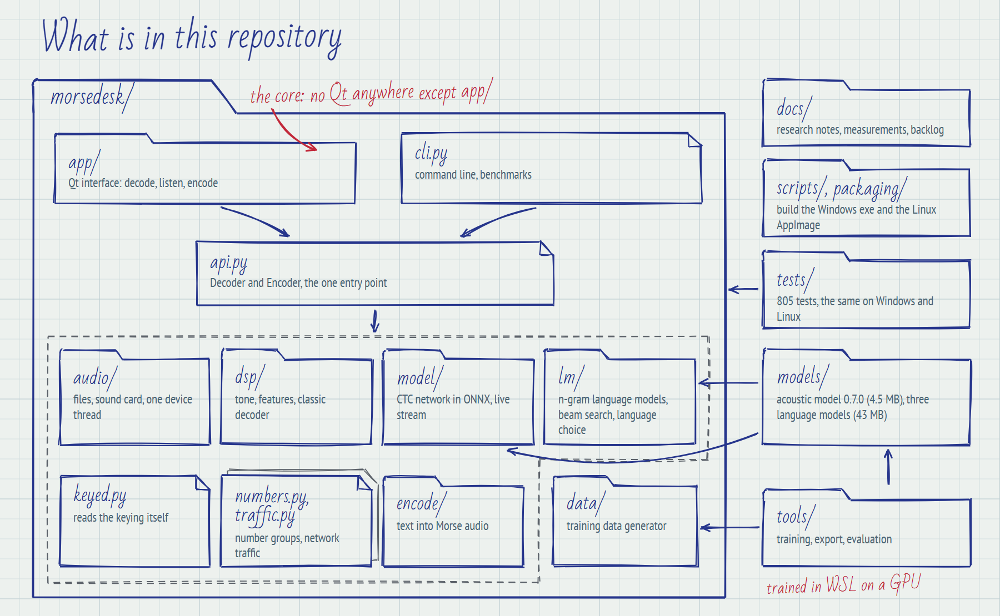
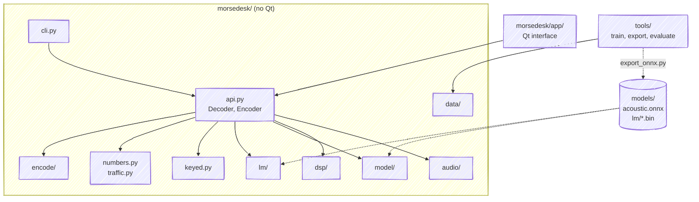
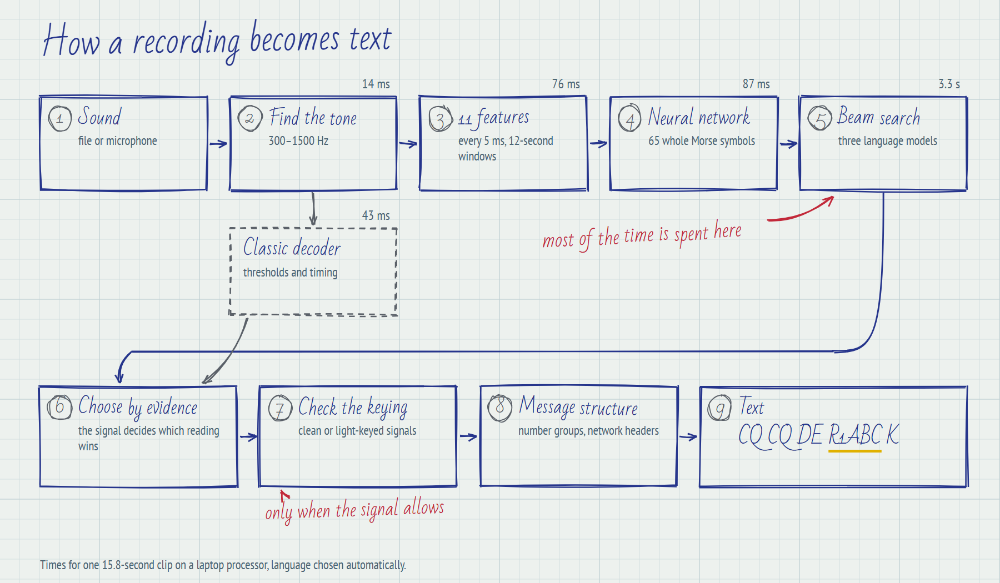
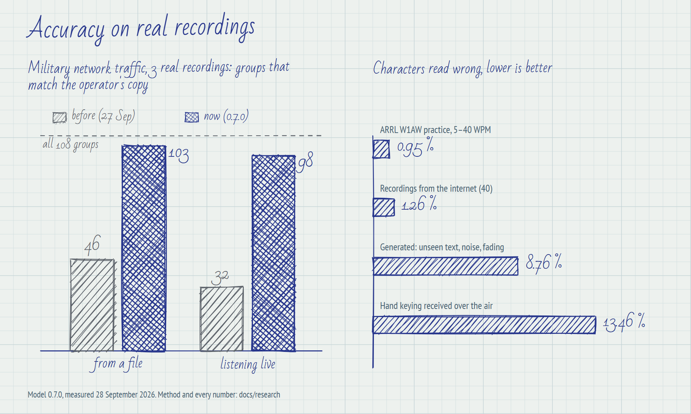

<picture>
  <source media="(prefers-color-scheme: dark)" srcset="docs/readme/img/hero-en-dark.png">
  
</picture>

**English** | [Русский](README.ru.md) | [Қазақша](README.kk.md)

MorseDesk decodes Morse code from audio files or a sound card and turns text into Morse audio, in
English, Russian and Kazakh. It runs offline on Windows and Linux. The neural network, the three
language models and the interface are all in this repository, so a clone is enough to run it.

This page describes the repository: what lives where, how the decoder works, and how to run, test,
build and retrain it. To use the program without Python, download a ready build from
[Releases](https://github.com/manh2303code/morsedesk/releases).

- [What is in the repository](#what-is-in-the-repository)
- [How decoding works](#how-decoding-works)
- [Accuracy](#accuracy)
- [Downloads](#downloads)
- [Running from source](#running-from-source)
- [Tests](#tests)
- [Building the release files](#building-the-release-files)
- [Training and evaluation](#training-and-evaluation)
- [Documentation](#documentation)
- [Licenses](#licenses)

## What is in the repository

<picture>
  <source media="(prefers-color-scheme: dark)" srcset="docs/readme/img/repo-en-dark.png">
  
</picture>

| Path | What it holds |
|---|---|
| `morsedesk/` | The core package. Nothing outside `app/` imports Qt, so the command line and the benchmarks run on a machine without a display. |
| `morsedesk/api.py` | `Decoder` and `Encoder`, the one entry point. The interface and the command line both go through it. |
| `morsedesk/audio/` | Reading and writing audio files, sound card capture and playback. Every PortAudio call runs on one device thread. |
| `morsedesk/dsp/` | Tone search, the 11 features, the classic threshold decoder, and the choice between the two readings. |
| `morsedesk/model/` | The CTC network through ONNX Runtime, 12-second windows, live streaming. |
| `morsedesk/lm/` | Character n-gram language models, beam search, language identification. |
| `morsedesk/keyed.py` | Checks the text against the measured keying on clean or light-keyed signals. |
| `morsedesk/numbers.py`, `traffic.py` | Number groups and abbreviated digits; the layout of network traffic messages (header, RMKS, groups). |
| `morsedesk/encode/` | Text into Morse timing and audio. |
| `morsedesk/data/` | Synthetic training data: keying styles, noise, fading, interference, text sources. |
| `morsedesk/app/` | The Qt interface (PySide6): Decode, Listen and Encode pages, documentation in three languages. |
| `models/` | `acoustic.onnx`, model 0.7.0 (4.5 MB), and `lm/{en,ru,kk}.bin`, the language models (43 MB). |
| `tools/` | Training, ONNX export, language model building, evaluation and benchmarks. |
| `tests/` | 805 tests in `unit/`, `app/` (Qt) and `regression/`. |
| `scripts/`, `packaging/` | Building and checking the Windows exe and the Linux AppImage; running the tests on Linux. |
| `docs/` | Research notes with every measurement, the backlog, and the sources of the images on this page. |
| `testdata/` | Only a README. The test recordings are not published. |

The same dependencies as a graph:



## How decoding works

<picture>
  <source media="(prefers-color-scheme: dark)" srcset="docs/readme/img/pipeline-en-dark.png">
  
</picture>

1. The tone is located between 300 and 1500 Hz.
2. Every 5 ms the signal becomes 11 features. Long recordings are cut into 12-second windows that
   overlap by 10 seconds.
3. A bidirectional GRU with 1,119,425 parameters gives CTC probabilities over 65 classes. Each class
   is a whole Morse character such as `.-` or `-...`, not a single dot or dash.
4. Beam search combines those probabilities with a character 6-gram language model of each
   language. When the language is set to automatic, all three are tried, and this is where most of
   the time goes.
5. A classic threshold decoder reads the same signal in parallel, and `dsp/selection.py` keeps the
   reading that the signal supports better.
6. On clean or light-keyed signals `keyed.py` compares the text with the measured keying.
7. `numbers.py` and `traffic.py` restore digit groups and the layout of network traffic messages.

Every character keeps its own confidence, and the interface underlines words the network did not
hear clearly.

## Accuracy

<picture>
  <source media="(prefers-color-scheme: dark)" srcset="docs/readme/img/results-en-dark.png">
  
</picture>

| Test set | What it is | Model 0.7.0 |
|---|---|---|
| T7 | 3 real military network traffic recordings, checked against the operator's copy | 103 of 108 groups from a file, 98 of 108 live (on 27 September: 46 and 32) |
| T2 | ARRL W1AW code practice, 10 real recordings at 5–40 WPM | 0.95 % character errors; none at all from 18 to 40 WPM |
| T4 | 40 real recordings from the internet | 1.26 % |
| T4, SAQ | hand keying received over the air | 13.46 %, the largest gap left |
| dev-OOV | 500 generated clips: text the model never saw, noise, interference, fading | 8.76 % |

Measured on 28 September 2026. How each set was built, and every number with its error margin, is
in `docs/research/` and in the documentation inside the program.

## Downloads

[Releases](https://github.com/manh2303code/morsedesk/releases) has two files and their checksums:

| System | File |
|---|---|
| Windows | `MorseDesk.exe`, one file of about 140 MB. Double-click it; nothing is installed. |
| Linux | `MorseDesk-x86_64.AppImage`. Install it once with `bash install_linux.sh MorseDesk-x86_64.AppImage`, using the script from `scripts/` in this repository. A file copied from a USB stick or from Windows loses its executable bit, and a double-click then silently does nothing. |

Check a download with `sha256sum -c --ignore-missing SHA256SUMS`.

## Running from source

You need Python 3.11 and [uv](https://docs.astral.sh/uv/).

```bash
git clone https://github.com/manh2303code/morsedesk
cd morsedesk
uv sync --extra runtime --extra gui     # --all-extras adds tests and training
uv run morsedesk-gui
```

On Windows you can double-click `MorseDesk.cmd` instead: on the first run it installs what is
missing, then opens the interface. On Linux, listening and playback need `libportaudio2`.

The command line:

```bash
uv run morsedesk decode recording.wav                    # language chosen automatically
uv run morsedesk decode recording.wav --profile ru --json
uv run morsedesk encode "CQ CQ DE R1ABC K" --wpm 20 --out cq.wav
uv run morsedesk devices                                 # list sound devices
```

Profiles are `en`, `ru`, `kk-cyrl-ru` (Kazakh) and `auto`. On Windows, set `PYTHONUTF8=1` so that
Cyrillic text prints correctly.

## Tests

```bash
uv sync --all-extras
PYTHONUTF8=1 uv run pytest -p no:warnings
```

`-p no:warnings` keeps the PyTorch warnings out of the summary. No test opens a real sound device:
`tests/conftest.py` replaces `sounddevice` for every test. `scripts/test_linux.sh` runs the same
tests on Linux in a separate virtual environment, with Qt offscreen. Tests marked `gate` run the model
on the generated set T1 (`tools/make_t1.py`) and run with `-m gate`.

## Building the release files

Windows, in PowerShell 7:

```powershell
pwsh -File scripts/build_windows.ps1       # dist/MorseDesk.exe
pwsh -File scripts/test_windows_exe.ps1    # starts the exe and compares --self-test with the source
```

Linux AppImage, built in Ubuntu 22.04 with Docker:

```bash
docker build -f packaging/Dockerfile.build -t morsedesk-build .
docker run --rm -v "$PWD":/src morsedesk-build bash scripts/build_appimage.sh
# dist/MorseDesk-x86_64.AppImage and dist/SHA256SUMS

docker build -f packaging/Dockerfile.test -t morsedesk-test .
docker run --rm -v "$PWD":/work morsedesk-test bash /work/scripts/test_appimage.sh
```

Run `test_windows_exe.ps1` first: it writes the samples in `dist/selftest/` that `test_appimage.sh`
checks against. Do not build the two at the same time, because the AppImage build clears the
`build/` folder that the Windows build uses.

## Training and evaluation

The acoustic model learns only from synthetic audio that `morsedesk/data` generates on the fly:
text, keying, noise, fading and interference, including light keying measured on real recordings.

```bash
uv sync --all-extras
PYTHONUTF8=1 uv run python -m tools.train --name my_run --steps 30000 --device auto
PYTHONUTF8=1 uv run python tools/export_onnx.py --checkpoint runs/my_run/best.pt --out models/eval_my_run.onnx
```

On the development machine training runs in WSL on a GPU (`scripts/wsl_train.sh`, about 0.05 s per
step, so 30,000 steps take about half an hour). The settings of every model so far are in
`docs/research/03-model-experiments.md`.

```bash
PYTHONUTF8=1 uv run python tools/make_t1.py           # T1: 500 generated clips
PYTHONUTF8=1 uv run morsedesk bench --manifest testdata/generated/t1/manifest.jsonl --engine onnx --out-dir runs/t1
PYTHONUTF8=1 uv run python tools/long_random_eval.py  # two-minute messages in three languages
```

The real recordings (T2, T4 to T7) are not in the repository: some may only be used internally,
others are private. The tools that collected them, `tools/fetch_t2.py` and `tools/make_t4.py`, are
included and name their sources.

The language models are built from text corpora with KenLM: `tools/fetch_corpus.py`, then
`tools/normalize_corpus.py`, `tools/build_lm.sh` and `tools/arpa_to_bin.py`. The corpora and their
licenses are listed in `models/lm/LICENSES.md`.

## Documentation

- `morsedesk/app/docs/technical_{en,ru,kk}.html`: the full technical description with
  measurements. The program shows it in the interface language and can save it as PDF.
- `docs/research/`: every experiment and measurement (in Vietnamese). 02 baseline numbers,
  03 model experiments, 04 pretrained baselines, 05 numbers, 06 network traffic and light keying.
- `docs/backlog.md`: open work.
- `CLAUDE.md`: notes for working on the code, with the architecture boundaries and known pitfalls
  (in Vietnamese).
- `docs/readme/`: the sources of the images on this page. `uv run python docs/readme/render.py`
  redraws them with Edge or Chrome.

## Licenses

`pyproject.toml` declares the MorseDesk code proprietary; no open-source license is attached.
Third-party files keep their own licenses: the DejaVu and Noto Sans fonts in `morsedesk/app/fonts`,
the language model corpora in `models/lm/LICENSES.md`, and in `docs/readme/src` the Bad Script and
PT Sans Narrow fonts (SIL Open Font License) and rough.js (MIT).
