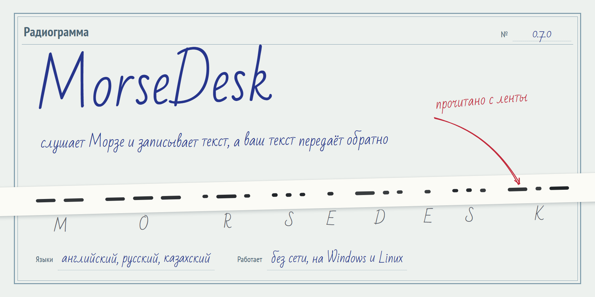
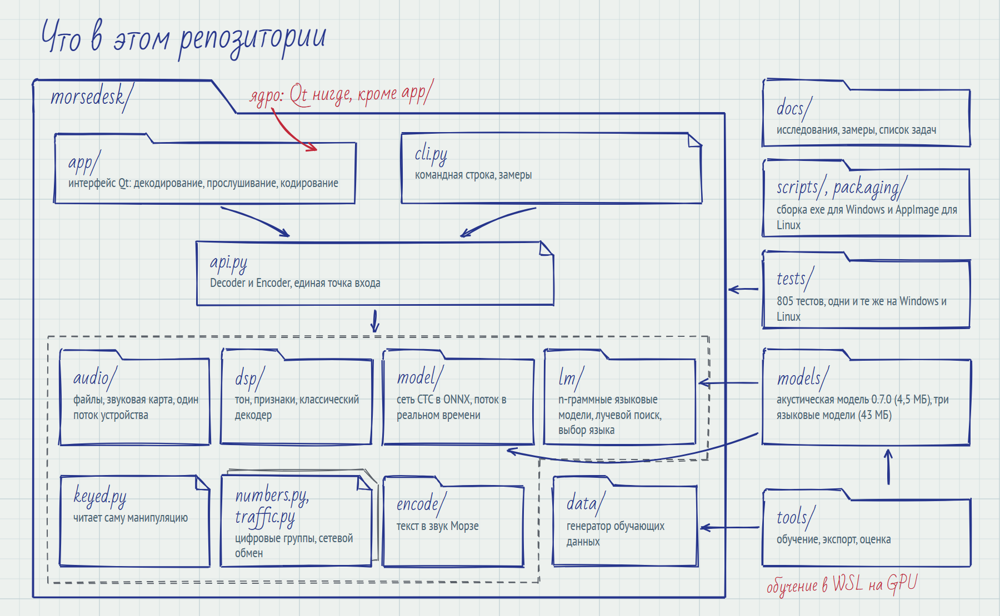
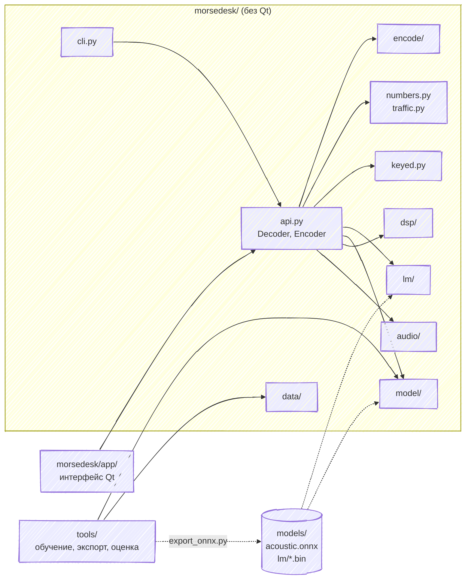
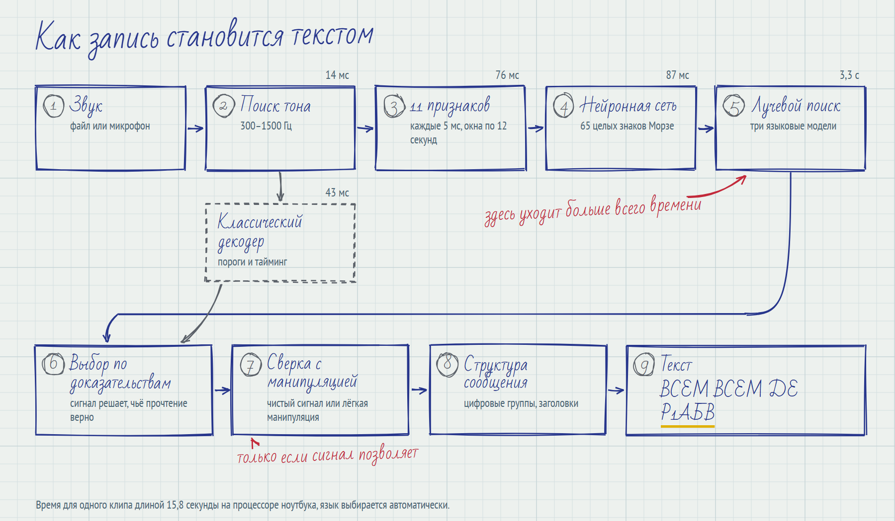
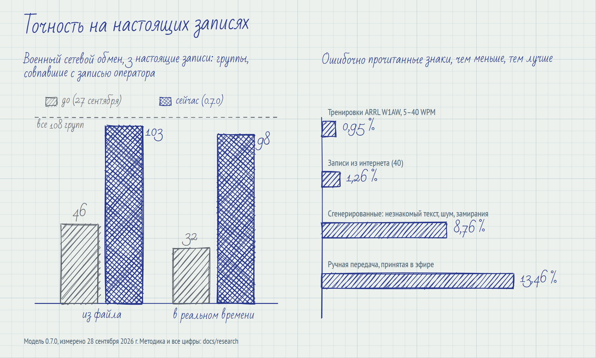

<picture>
  <source media="(prefers-color-scheme: dark)" srcset="docs/readme/img/hero-ru-dark.png">
  
</picture>

[English](README.md) | **Русский** | [Қазақша](README.kk.md)

MorseDesk декодирует азбуку Морзе из аудиофайлов и со звуковой карты и превращает текст в звук
Морзе на английском, русском и казахском языках. Программа работает без сети на Windows и Linux.
Нейронная сеть, три языковые модели и интерфейс лежат в этом репозитории, поэтому для запуска
достаточно его клонировать.

Эта страница описывает репозиторий: что где лежит, как устроен декодер и как его запускать,
тестировать, собирать и обучать заново. Чтобы пользоваться программой без Python, скачайте готовую
сборку на странице [Releases](https://github.com/manh2303code/morsedesk/releases).

- [Что в репозитории](#что-в-репозитории)
- [Как запись становится текстом](#как-запись-становится-текстом)
- [Точность](#точность)
- [Скачать](#скачать)
- [Запуск из исходников](#запуск-из-исходников)
- [Тесты](#тесты)
- [Сборка релизов](#сборка-релизов)
- [Обучение и оценка](#обучение-и-оценка)
- [Документация](#документация)
- [Лицензии](#лицензии)

## Что в репозитории

<picture>
  <source media="(prefers-color-scheme: dark)" srcset="docs/readme/img/repo-ru-dark.png">
  
</picture>

| Путь | Что там |
|---|---|
| `morsedesk/` | Ядро. Qt не импортируется нигде, кроме `app/`, поэтому командная строка и замеры работают на машине без дисплея. |
| `morsedesk/api.py` | `Decoder` и `Encoder`, единая точка входа. Через неё работают и интерфейс, и командная строка. |
| `morsedesk/audio/` | Чтение и запись аудиофайлов, запись со звуковой карты и воспроизведение. Все вызовы PortAudio идут из одного потока устройства. |
| `morsedesk/dsp/` | Поиск тона, 11 признаков, классический пороговый декодер и выбор между двумя прочтениями. |
| `morsedesk/model/` | Сеть CTC через ONNX Runtime, окна по 12 секунд, поток в реальном времени. |
| `morsedesk/lm/` | Символьные n-граммные языковые модели, лучевой поиск, определение языка. |
| `morsedesk/keyed.py` | Сверяет текст с измеренной манипуляцией, когда сигнал чистый или манипуляция лёгкая. |
| `morsedesk/numbers.py`, `traffic.py` | Цифровые группы и сокращённые цифры; структура сообщений сетевого обмена (заголовок, RMKS, группы). |
| `morsedesk/encode/` | Текст в тайминг и звук Морзе. |
| `morsedesk/data/` | Синтетические обучающие данные: манеры передачи, шум, замирания, помехи, источники текста. |
| `morsedesk/app/` | Интерфейс на Qt (PySide6): страницы декодирования, прослушивания и кодирования, документация на трёх языках. |
| `models/` | `acoustic.onnx`, модель 0.7.0 (4,5 МБ), и `lm/{en,ru,kk}.bin`, языковые модели (43 МБ). |
| `tools/` | Обучение, экспорт в ONNX, сборка языковых моделей, оценка и замеры. |
| `tests/` | 805 тестов в `unit/`, `app/` (Qt) и `regression/`. |
| `scripts/`, `packaging/` | Сборка и проверка exe для Windows и AppImage для Linux; запуск тестов на Linux. |
| `docs/` | Исследования со всеми замерами, список задач и исходники картинок этой страницы. |
| `testdata/` | Только README. Тестовые записи не публикуются. |

Те же зависимости в виде графа:



## Как запись становится текстом

<picture>
  <source media="(prefers-color-scheme: dark)" srcset="docs/readme/img/pipeline-ru-dark.png">
  
</picture>

1. Тон ищется в диапазоне 300–1500 Гц.
2. Каждые 5 мс сигнал превращается в 11 признаков. Длинные записи режутся на окна по 12 секунд,
   которые перекрываются на 10 секунд.
3. Двунаправленная GRU с 1 119 425 параметрами выдаёт вероятности CTC по 65 классам. Каждый класс —
   целый знак Морзе, например `.-` или `-...`, а не отдельная точка или тире.
4. Лучевой поиск объединяет эти вероятности с символьной 6-граммной языковой моделью каждого языка.
   При автоматическом выборе языка пробуются все три, и на это уходит больше всего времени.
5. Классический пороговый декодер параллельно читает тот же сигнал, а `dsp/selection.py` оставляет
   прочтение, которое лучше подтверждается сигналом.
6. Если сигнал чистый или манипуляция лёгкая, `keyed.py` сверяет текст с измеренной манипуляцией.
7. `numbers.py` и `traffic.py` восстанавливают цифровые группы и структуру сообщений сетевого обмена.

У каждого знака своя уверенность, и интерфейс подчёркивает слова, которые сеть расслышала нечётко.

## Точность

<picture>
  <source media="(prefers-color-scheme: dark)" srcset="docs/readme/img/results-ru-dark.png">
  
</picture>

| Набор | Что это | Модель 0.7.0 |
|---|---|---|
| T7 | 3 настоящие записи военного сетевого обмена, сверка с записью оператора | 103 из 108 групп из файла, 98 из 108 в реальном времени (27 сентября: 46 и 32) |
| T2 | тренировки ARRL W1AW, 10 настоящих записей на 5–40 WPM | 0,95 % ошибочных знаков; на 18–40 WPM ни одной ошибки |
| T4 | 40 настоящих записей из интернета | 1,26 % |
| T4, SAQ | ручная передача, принятая в эфире | 13,46 %, самый большой оставшийся разрыв |
| dev-OOV | 500 сгенерированных клипов: незнакомый модели текст, шум, помехи, замирания | 8,76 % |

Измерено 28 сентября 2026 г. Как собран каждый набор и все цифры с погрешностями — в
`docs/research/` и в документации внутри программы.

## Скачать

На странице [Releases](https://github.com/manh2303code/morsedesk/releases) два файла и их
контрольные суммы:

| Система | Файл |
|---|---|
| Windows | `MorseDesk.exe`, один файл около 140 МБ. Запустите двойным щелчком, установка не нужна. |
| Linux | `MorseDesk-x86_64.AppImage`. Установите один раз командой `bash install_linux.sh MorseDesk-x86_64.AppImage`, скрипт лежит в `scripts/` этого репозитория. Файл, скопированный с флешки или из Windows, теряет право на выполнение, и двойной щелчок по нему молча ничего не делает. |

Проверка загрузки: `sha256sum -c --ignore-missing SHA256SUMS`.

## Запуск из исходников

Нужны Python 3.11 и [uv](https://docs.astral.sh/uv/).

```bash
git clone https://github.com/manh2303code/morsedesk
cd morsedesk
uv sync --extra runtime --extra gui     # --all-extras добавляет тесты и обучение
uv run morsedesk-gui
```

На Windows можно просто дважды щёлкнуть `MorseDesk.cmd`: при первом запуске он установит
недостающее и откроет интерфейс. На Linux для прослушивания и воспроизведения нужен `libportaudio2`.

Командная строка:

```bash
uv run morsedesk decode recording.wav                    # язык выбирается автоматически
uv run morsedesk decode recording.wav --profile ru --json
uv run morsedesk encode "CQ CQ DE R1ABC K" --wpm 20 --out cq.wav
uv run morsedesk devices                                 # список звуковых устройств
```

Профили: `en`, `ru`, `kk-cyrl-ru` (казахский) и `auto`. На Windows задайте `PYTHONUTF8=1`, чтобы
кириллица выводилась правильно.

## Тесты

```bash
uv sync --all-extras
PYTHONUTF8=1 uv run pytest -p no:warnings
```

`-p no:warnings` убирает предупреждения PyTorch из итогов. Ни один тест не открывает настоящее
звуковое устройство: `tests/conftest.py` подменяет `sounddevice` для всех тестов.
`scripts/test_linux.sh` запускает те же тесты на Linux в отдельном виртуальном окружении, Qt без
экрана. Тесты с меткой `gate` прогоняют модель на сгенерированном наборе T1 (`tools/make_t1.py`) и
запускаются с `-m gate`.

## Сборка релизов

Windows, в PowerShell 7:

```powershell
pwsh -File scripts/build_windows.ps1       # dist/MorseDesk.exe
pwsh -File scripts/test_windows_exe.ps1    # запускает exe и сравнивает --self-test с исходниками
```

AppImage для Linux собирается в Ubuntu 22.04 через Docker:

```bash
docker build -f packaging/Dockerfile.build -t morsedesk-build .
docker run --rm -v "$PWD":/src morsedesk-build bash scripts/build_appimage.sh
# dist/MorseDesk-x86_64.AppImage и dist/SHA256SUMS

docker build -f packaging/Dockerfile.test -t morsedesk-test .
docker run --rm -v "$PWD":/work morsedesk-test bash /work/scripts/test_appimage.sh
```

Сначала запустите `test_windows_exe.ps1`: он записывает образцы в `dist/selftest/`, с которыми
сверяется `test_appimage.sh`. Не собирайте обе сборки одновременно: сборка AppImage очищает папку
`build/`, которой пользуется сборка для Windows.

## Обучение и оценка

Акустическая модель учится только на синтетическом звуке, который `morsedesk/data` генерирует на
лету: текст, манипуляция, шум, замирания и помехи, включая лёгкую манипуляцию, измеренную на
настоящих записях.

```bash
uv sync --all-extras
PYTHONUTF8=1 uv run python -m tools.train --name my_run --steps 30000 --device auto
PYTHONUTF8=1 uv run python tools/export_onnx.py --checkpoint runs/my_run/best.pt --out models/eval_my_run.onnx
```

На машине разработчика обучение идёт в WSL на GPU (`scripts/wsl_train.sh`, около 0,05 с на шаг,
30 000 шагов — примерно полчаса). Настройки всех моделей описаны в
`docs/research/03-model-experiments.md`.

```bash
PYTHONUTF8=1 uv run python tools/make_t1.py           # T1: 500 сгенерированных клипов
PYTHONUTF8=1 uv run morsedesk bench --manifest testdata/generated/t1/manifest.jsonl --engine onnx --out-dir runs/t1
PYTHONUTF8=1 uv run python tools/long_random_eval.py  # двухминутные сообщения на трёх языках
```

Настоящих записей (T2, T4–T7) в репозитории нет: часть можно использовать только внутри проекта,
остальные частные. Инструменты, которые их собирали, `tools/fetch_t2.py` и `tools/make_t4.py`,
включены и указывают источники.

Языковые модели строятся по текстовым корпусам с помощью KenLM: `tools/fetch_corpus.py`, затем
`tools/normalize_corpus.py`, `tools/build_lm.sh` и `tools/arpa_to_bin.py`. Корпуса и их лицензии
перечислены в `models/lm/LICENSES.md`.

## Документация

- `morsedesk/app/docs/technical_{en,ru,kk}.html`: полное техническое описание с замерами. Программа
  показывает его на языке интерфейса и умеет сохранить в PDF.
- `docs/research/`: все эксперименты и замеры (на вьетнамском). 02 — исходные цифры, 03 —
  эксперименты с моделью, 04 — готовые модели для сравнения, 05 — числа, 06 — сетевой обмен и
  лёгкая манипуляция.
- `docs/backlog.md`: открытые задачи.
- `CLAUDE.md`: заметки для работы с кодом, границы архитектуры и известные ловушки (на вьетнамском).
- `docs/readme/`: исходники картинок этой страницы. `uv run python docs/readme/render.py`
  перерисовывает их через Edge или Chrome.

## Лицензии

В `pyproject.toml` код MorseDesk объявлен проприетарным; открытой лицензии нет. Сторонние файлы
сохраняют свои лицензии: шрифты DejaVu и Noto Sans в `morsedesk/app/fonts`, корпуса языковых
моделей в `models/lm/LICENSES.md`, а в `docs/readme/src` шрифты Bad Script и PT Sans Narrow
(SIL Open Font License) и rough.js (MIT).
